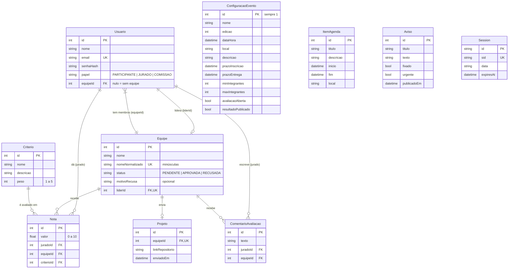

# Arquitetura

O sistema é um **monolito Express** que desenha as páginas no servidor com **EJS**. Não há API JSON nem SPA: o navegador pede uma página, o servidor responde HTML pronto. O pouco de JavaScript no navegador (`src/public/js/`) só abre o menu no celular e preenche o login de demonstração.

## Visão geral

```mermaid
flowchart LR
  N[Navegador] -->|GET / POST de formulário| E[Express<br/>src/app.js]
  E --> M[Middlewares<br/>helmet · sessão · usuário · CSRF · locais]
  M --> R[Rotas<br/>*.routes.js]
  R -->|papel + validação zod| C[Controllers<br/>*.controller.js]
  C --> S[Services<br/>*.service.js<br/>regras de negócio]
  S --> P[Prisma<br/>src/lib/prisma.js]
  P --> B[(SQLite em dev/testes<br/>PostgreSQL em produção)]
  C -->|res.render| V[Views EJS<br/>layout + partials]
  V --> N
  S -. lança ErroValidacao, ErroRegraNegocio... .-> X[Middleware de erros<br/>src/middlewares/erros.js]
  X -->|formulário de volta, 403, 404, 500| N
```

### Camadas e responsabilidades

| Camada      | Pasta                           | Faz                                                                  | Não faz                      |
| ----------- | ------------------------------- | -------------------------------------------------------------------- | ---------------------------- |
| Rotas       | `src/modules/*/*.routes.js`     | Liga URL + middlewares (papel, validação) a uma função do controller | Lógica                       |
| Controller  | `src/modules/*/*.controller.js` | Lê `req`, chama o service, renderiza ou redireciona com mensagem     | Regra de negócio, Prisma     |
| Service     | `src/modules/*/*.service.js`    | Regras de negócio e acesso ao banco                                  | Conhecer `req`/`res`         |
| Schemas     | `src/modules/*/*.schemas.js`    | Formato dos dados de entrada (zod)                                   | Regras que dependem do banco |
| Middlewares | `src/middlewares/`              | Autenticação, CSRF, validação, erros, variáveis das views            |                              |
| Lib         | `src/lib/`                      | Peças compartilhadas: Prisma, erros, datas, constantes               |                              |

### Caminho de uma requisição (ordem dos middlewares em `src/app.js`)

1. `helmet` — cabeçalhos de segurança e Content-Security-Policy.
2. `express.static` — CSS, JS e imagens (antes da sessão, para não criar sessão à toa).
3. `definirLocaisPadrao` — valores seguros para as views (até a página de erro funciona se o banco cair).
4. `express.urlencoded` — lê o formulário.
5. `express-session` — sessão guardada no banco (`@quixo3/prisma-session-store`).
6. `adicionarFlash` — mensagens de uma vez só e formulário que volta preenchido.
7. `carregarUsuario` — busca o usuário da sessão no banco a cada requisição.
8. `disponibilizarTokenCsrf` e `carregarDadosDoSite` — token CSRF, evento e aviso urgente para as views.
9. `protecaoCsrf` — recusa qualquer POST sem o token certo.
10. Rotas dos módulos → 404 → middleware central de erros.

## Diagrama entidade-relacionamento



Restrições importantes garantidas pelo **banco**:

- `Usuario.email` único.
- `Equipe.nomeNormalizado` único → nome de equipe único sem diferenciar maiúsculas.
- `Equipe.liderId` único → uma pessoa lidera no máximo uma equipe.
- `Usuario.equipeId` é uma coluna só → uma pessoa está em no máximo uma equipe.
- `Nota (juradoId, equipeId, criterioId)` único → uma nota por jurado, equipe e critério; avaliar de novo faz `upsert`.
- `ComentarioAvaliacao (juradoId, equipeId)` único.
- Excluir uma equipe apaga o projeto, as notas e os comentários dela (`onDelete: Cascade`) e deixa os integrantes sem equipe (`SetNull`). Um critério com notas não pode ser apagado (`Restrict`).

## Decisões técnicas

| Decisão                                                          | Por quê                                                                                                                                                                                                                                |
| ---------------------------------------------------------------- | -------------------------------------------------------------------------------------------------------------------------------------------------------------------------------------------------------------------------------------- |
| **Monolito com páginas no servidor (Express + EJS)**             | O sistema é pequeno e de formulários. Sem SPA não há duas aplicações para manter, nem API para proteger em separado; o HTML já chega pronto e acessível.                                                                               |
| **Camadas routes → controller → service**                        | Cada arquivo tem um papel só. As regras ficam nos services, que podem ser testados sem HTTP.                                                                                                                                           |
| **Erros como classes (`lib/erros.js`) + middleware central**     | Os services só lançam o erro certo; um único lugar decide a resposta (formulário de volta, 403, 404, 500). O usuário nunca vê stack trace.                                                                                             |
| **Padrão Post/Redirect/Get com o formulário guardado na sessão** | Depois de um POST sempre há redirecionamento: recarregar a página não reenvia o formulário. Em caso de erro, os valores digitados e as mensagens voltam pela sessão e cada mensagem aparece junto do seu campo.                        |
| **zod para toda entrada**                                        | Valida e converte (texto → número, data, booleano) num lugar só, com mensagens em português. Campos extras (como `papel` no cadastro) são descartados.                                                                                 |
| **Prisma + SQLite em dev, compatível com PostgreSQL**            | SQLite não precisa de instalação (bom para Windows e para os testes). Não usamos enums nem buscas `insensitive`, que o SQLite não tem: papéis e status são textos validados pelo código e o nome da equipe tem uma coluna normalizada. |
| **Banco de testes separado (`.env.test`)**                       | Os testes apagam dados à vontade sem tocar no banco de desenvolvimento. O Jest recria `prisma/teste.db` antes de rodar.                                                                                                                |
| **Ranking como função pura (`calcularRanking`)**                 | O cálculo recebe listas e devolve o resultado, sem banco. É fácil de entender e de testar com muitos cenários de empate.                                                                                                               |
| **Critério sem nota fica fora da média ponderada**               | Durante a avaliação, uma equipe pode ter notas só em alguns critérios. Contar o critério vazio como zero puniria a equipe por algo que o jurado ainda não fez.                                                                         |
| **Desempate com pesos iguais pela ordem de cadastro**            | O regulamento manda desempatar "pelo critério de maior peso". Quando dois critérios têm o mesmo peso, usamos a ordem em que foram cadastrados, que é previsível e explicável.                                                          |
| **Sessão no banco (express-session + store do Prisma)**          | Sessões sobrevivem a reinícios do servidor (no Render, a cada deploy) e funcionam com mais de uma instância.                                                                                                                           |
| **CSRF com `csrf-sync`**                                         | A `csurf` foi descontinuada. O `csrf-sync` usa o padrão synchronizer token, guardado na sessão.                                                                                                                                        |
| **Datas sempre no horário de Brasília**                          | Exibição com `Intl.DateTimeFormat` e `America/Sao_Paulo`; os campos `datetime-local` são lidos com deslocamento −03:00 (o Brasil não tem horário de verão desde 2019).                                                                 |
| **CSS próprio com tokens**                                       | A identidade visual pedida é simples e sóbria; um framework traria estilos que precisaríamos desfazer. Todos os valores vêm de `tokens.css`.                                                                                           |
| **Usuário recarregado do banco a cada requisição**               | Se a comissão muda o papel de alguém, vale na hora, sem esperar a pessoa sair e entrar.                                                                                                                                                |
