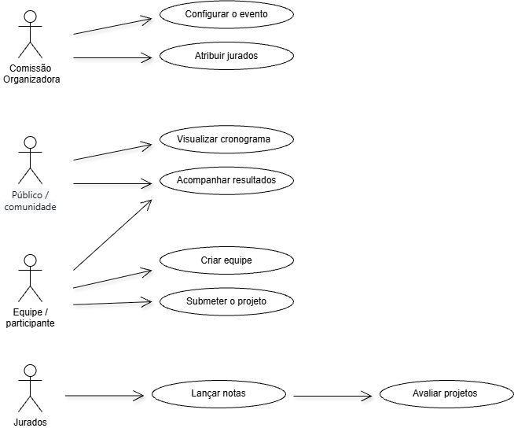

# Diagrama de casos de uso
 

 
📁 Arquivo editável: [`diagrama-casos-de-uso.drawio.png`](../diagrama-casos-de-uso.drawio.png) (abra no [draw.io](https://app.diagrams.net) pra editar) 
## Atores
 
| Ator | Casos de uso |
|---|---|
| Comissão Organizadora | Configurar o evento, Atribuir jurados |
| Público / comunidade | Visualizar cronograma, Acompanhar resultados |
| Equipe / participante | Acompanhar resultados, Criar equipe, Submeter o projeto |
| Jurados | Lançar notas (que inclui Avaliar projetos) |
 
---
 
[⬅ Voltar ao índice](README.md)
